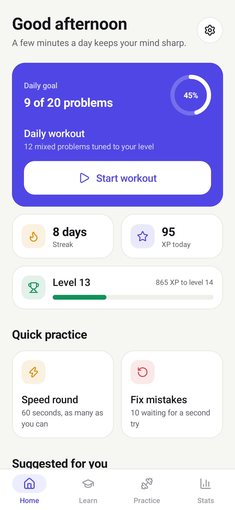
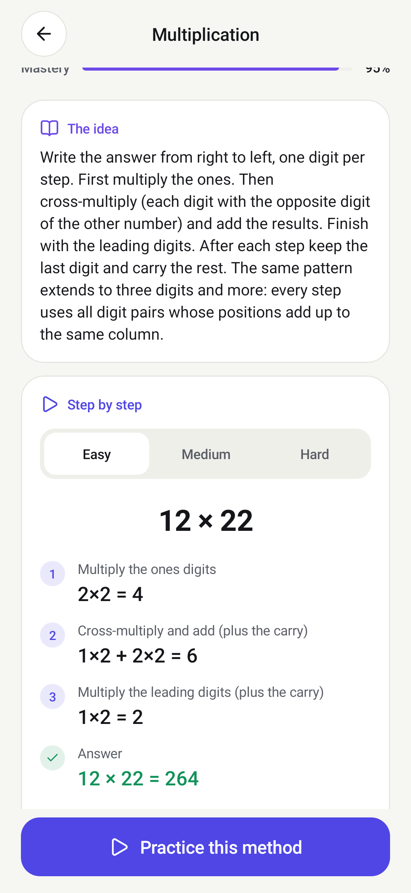
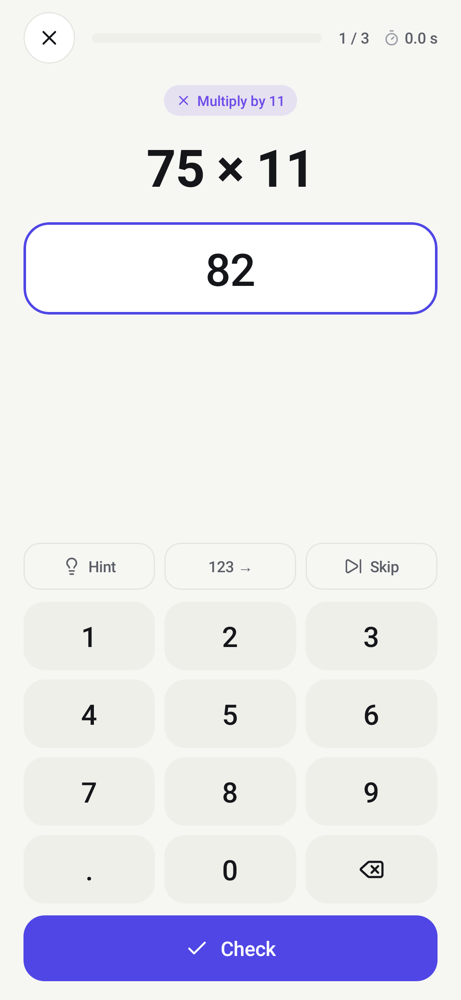
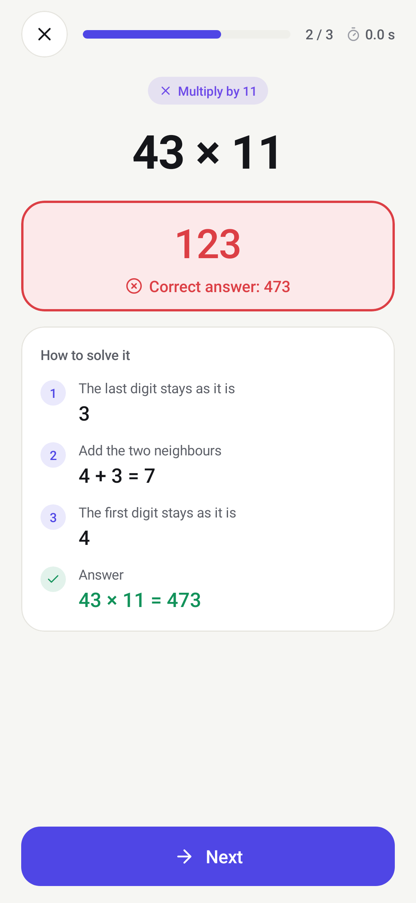
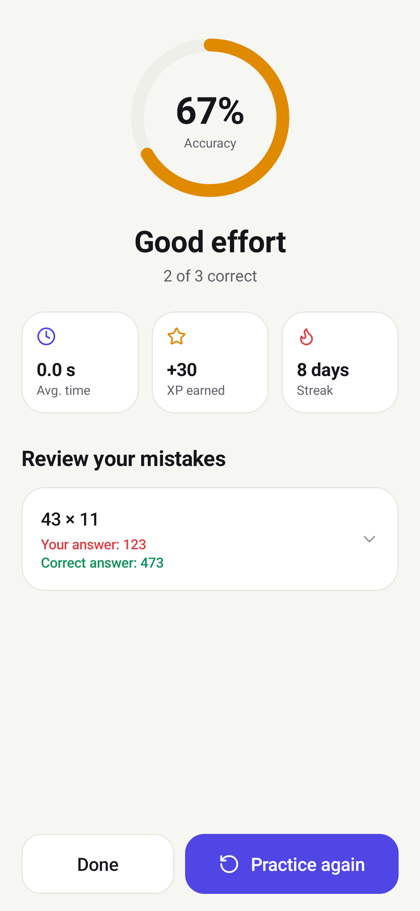
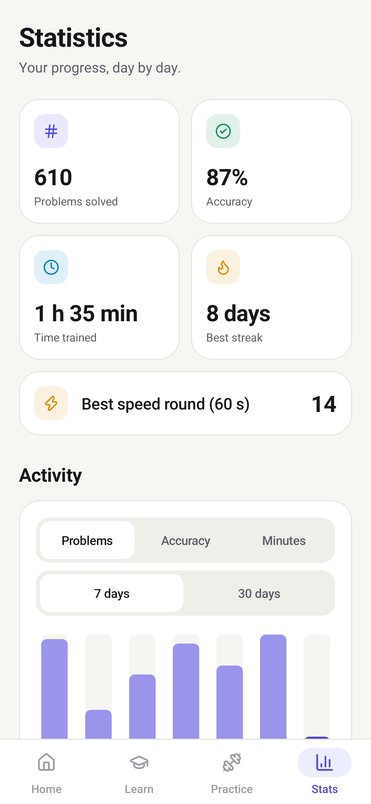
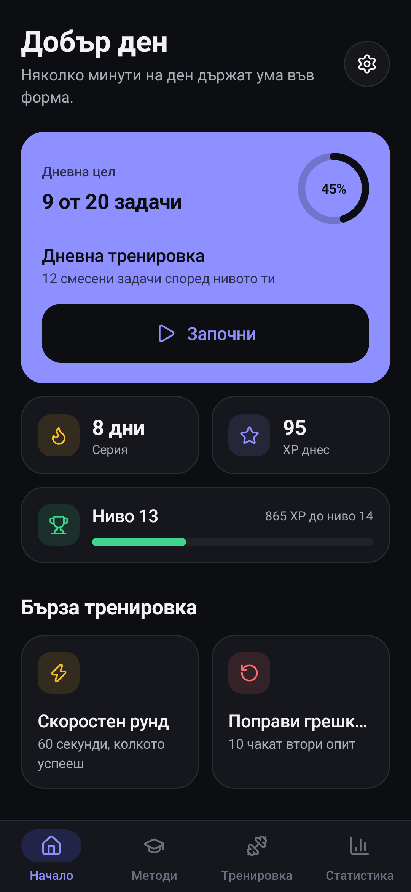
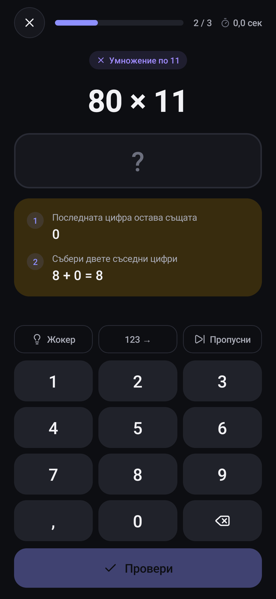

# MindMath

A mental math trainer for Android, written in Kotlin with Jetpack Compose.
Learn 23 calculation techniques with step-by-step demonstrations, practise
them, and follow your progress day by day.

- Package: `com.vislupus.mindmath`, portrait only, Android 8.0+
- Languages: English (default) and Bulgarian, switchable in Settings
- Fully offline, no permissions; all data stays in the app's private folder
- Release APK size: about 1.2 MB

| Home | Lesson | Practice | Solution |
| --- | --- | --- | --- |
|  |  |  |  |

| Result | Statistics | Bulgarian, dark | Hint |
| --- | --- | --- | --- |
|  |  |  |  |

## Three commands

Run them from the project folder in CMD or PowerShell (or double-click).

| Command | What it does |
| --- | --- |
| `run.bat` | Builds the development version, installs it on the connected phone or running emulator and starts it |
| `build-release.bat` | Builds the signed APK: `app\build\outputs\apk\release\app-release.apk` |
| `build-release.bat install` | Builds the APK, installs it on the phone and starts it |

The scripts use the JDK that ships with Android Studio
(`C:\Program Files\Android\Android Studio\jbr`). To use another JDK 17-21:
`set "MINDMATH_JDK=C:\path\to\jdk"` before running them.

The development version is installed as a separate app, **MindMath Dev**, with
its own data, so experiments never touch your real progress.

### Live preview while editing ("hot reload")

1. Open the project folder in Android Studio and press **Run**.
2. Enable **Settings > Editor > Live Edit** and choose *Push Edits Automatically*.

Changes to the screens (`app/src/.../ui`) then appear on the phone as you type.
Changes to values in `config/` need **Apply Changes** (Ctrl+F10) or Run again,
which takes a few seconds. `ui/Previews.kt` shows the building blocks directly
inside Android Studio without a device.

### Phone setup (once)

On the Redmi: *Settings > About phone* > tap *MIUI version* 7 times, then
*Additional settings > Developer options* > enable **USB debugging** and
**Install via USB**.

## Change anything in `config/`

You should never need to open the source tree for look or behaviour.

| File | Controls |
| --- | --- |
| `config/build.properties` | App id, app name, **version number**, SDK levels, signing |
| `config/AppConfig.kt` | Session lengths, daily goal, timers, difficulty, XP, streak rules, achievements, database name, **which methods are shown and in what order** |
| `config/ThemeConfig.kt` | Colours (light and dark), spacing, corner radii, text sizes, animation speed, font switch |
| `config/IconConfig.kt` | Which icon is used where |
| `config/TextsEn.kt` | Every English text, including all lessons |
| `config/TextsBg.kt` | Every Bulgarian text |

Images and fonts are in `app/src/main/res` (`drawable`, `font`, `mipmap-*`).

### Icons

All icons are from [Lucide](https://lucide.dev/icons/). To add one:

```cmd
python tools\add_icon.py flame chart-column
```

Then point an entry in `config/IconConfig.kt` at `R.drawable.lucide_<name>`.

## Releasing a new version

1. In `config/build.properties` raise `app.versionCode` by 1 and set `app.versionName`.
2. Run `build-release.bat install`.

**Back up `keystore\mindmath-release.jks`.** It is created on the first release
build and is not stored in Git. Android only accepts updates signed with the
same key; if the file is lost, the app has to be uninstalled (losing its data)
before a new build can be installed. Never change `app.id` for the same reason.

## What is inside

**Methods (23)** - each with the idea, when to use it, a tip, and an animated
worked example at three difficulty levels:

- Addition & subtraction: left-to-right addition, round and adjust, subtract
  by rounding, change from a round number
- Multiplication: by 11; by 5/25/50/125; by 9/99/999; double and halve; by one
  digit; split one number; criss-cross (any number of digits); numbers near
  100; around the middle (difference of squares)
- Squares: ending in 5 (and its generalisation), any number
- Division: by one digit, by 5/25/50/125, in two steps (factors), by two digits
- Percentages: building blocks (10% / 5% / 1%), flip, discounts and mark-ups,
  "what percent is it?"

**Practice** - daily workout weighted towards your weak methods, method drills
(adaptive, easy, medium, hard), timed speed rounds, and "fix mistakes", which
brings back every problem you got wrong until you solve it. Hints reveal the
solution one step at a time; every wrong answer shows the full solution.
Answers can be typed right to left, the way ×11 and criss-cross produce them.

**Progress** - daily goal, streak, XP and levels, mastery per method, activity
charts for 7 and 30 days, a calendar heat map, per-method accuracy and speed,
personal bests and achievements.

## Data

Everything is stored in one SQLite database inside the app sandbox:
`/data/data/com.vislupus.mindmath/files/database/mindmath.db`

| Table | Content |
| --- | --- |
| `settings` | Language, theme, daily goal and other preferences |
| `sessions` | One row per practice session |
| `attempts` | Every answer: problem, your answer, correctness, time, hint, XP |
| `lessons` | Lessons you have opened |

## Tests

```cmd
gradlew.bat testDebugUnitTest --no-configuration-cache
```

Generates over 200 000 random problems and verifies every answer and every
line of every worked solution, in both languages.

```cmd
gradlew.bat testDebugUnitTest -Pscreenshots --tests "*Screenshots" --no-configuration-cache
```

Runs the real app on the computer and saves a picture of every screen to
`app\build\screenshots` (no phone needed).

## Project layout

```
config/                     everything you may want to change
app/src/main/java/.../
    core/                   maths: methods, problem generators, solutions, XP
    data/                   SQLite database and queries
    texts/                  structure of the text files
    ui/                     screens, components, theme, navigation
app/src/main/res/           icons (Lucide), font (Roboto), launcher icon
app/src/test/               maths tests
app/src/screenshots/        optional screenshot tests
tools/                      icon converter and helper scripts
```

## Credits

Icons: [Lucide](https://lucide.dev) (ISC License). Font: Roboto (Apache License 2.0).
